# Application architecture

```mermaid
flowchart TB
  subgraph Browser["Browser"]
    ClientUI["Client Components<br/>forms, filters, navigation"]
  end

  subgraph Next["Next.js App Router"]
    Routes["app/<br/>routes, layouts, loading, errors"]
    Proxy["proxy.ts<br/>optimistic account redirect"]
    RouteHandler["api/auth/[...all]<br/>Better Auth Route Handler"]

    subgraph Features["features/"]
      Auth["auth<br/>schemas, actions, auth UI"]
      Cabins["cabins<br/>queries, types, filters, UI"]
      Profile["profile<br/>queries, schemas, actions, UI"]
      Reservations["reservations<br/>queries, schemas, actions, UI"]
    end

    SharedUI["components/<br/>shared UI"]
    SharedLib["lib/<br/>action state, auth session, PostgreSQL pool"]

    subgraph SupabaseFactories["lib/supabase/"]
      DataFactory["data-client.ts<br/>public server data client"]
      Config["config.ts<br/>public URL + publishable key"]
    end
  end

  subgraph Database["Supabase"]
    AuthService["Better Auth<br/>PostgreSQL schema better_auth"]
    PublicData["Public cabin data<br/>Supabase Data API"]
    PrivateData["Guest profiles + bookings<br/>server-only PostgreSQL queries"]
    Drafts["supabase/drafts/<br/>review-only SQL"]
    EmptyMigrations["supabase/migrations/<br/>no tracked migrations"]
  end

  ClientUI -->|"Server Action calls"| Auth
  ClientUI -->|"Server Action calls"| Profile
  ClientUI -->|"Server Action calls"| Reservations
  Routes --> Features
  Routes --> SharedUI
  Routes --> Proxy
  RouteHandler --> AuthService
  Auth --> AuthService
  Profile --> AuthService
  Reservations --> AuthService
  Profile --> PrivateData
  Reservations --> PrivateData
  Cabins --> DataFactory --> Config
  SharedUI --> Features

  Proxy -->|"cookie-only optimistic redirect"| AuthService
  Auth -->|"sign in / sign up / sign out"| AuthService
  Profile -->|"verified session + owner-scoped SQL"| PrivateData
  Reservations -->|"verified session + owner-scoped SQL"| PrivateData
  Cabins -->|"cached public reads"| PublicData
  Drafts -.->|"not yet promoted / applied"| PrivateData
  EmptyMigrations -.->|"schema reproducibility gap"| Database
```

## Boundaries

- `app/` defines route entry points. Feature modules own feature-specific reads, writes, validation, and UI; `components/` and `lib/` hold shared UI and infrastructure.
- Client Components invoke exported Server Actions for auth, profile, and reservation mutations. Those actions validate submitted values and independently authenticate; profile and reservation operations derive the guest identity from the signed-in user.
- The shared server-render auth lookup is memoized per React request so the header and account data can reuse the same verified user result. Requests without a Better Auth session cookie skip the auth database lookup; requests with a cookie still verify it through Better Auth. Reservation bookings and the shared cached cabin catalog load concurrently.
- Better Auth owns account creation, email verification, and sessions. Its PostgreSQL tables are isolated in the `better_auth` schema, and its catch-all Route Handler is under `app/api/auth/[...all]`.
- `proxy.ts` checks for the Better Auth cookie only to redirect optimistically. Protected pages, Server Actions, and account data queries independently verify the session with Better Auth.
- Authenticated profile and reservation queries use the server-only PostgreSQL pool and include explicit Better Auth user ownership predicates. The pool must never be imported by client code. Supabase remains responsible for public cabin reads through its publishable key.
- Configure `BETTER_AUTH_SECRET`, `BETTER_AUTH_URL`, `DATABASE_URL`, `SMTP_URL`, and `EMAIL_FROM` before running the app. Verification emails are sent through the configured SMTP server; email verification is required for sessions.
- Cabin reads use the remote cache; account reads use private caching and user-specific tags. Mutations invalidate the relevant account tags and routes.
- Reservation dates are date-only values interpreted in the property's `Europe/Rome` time zone, independent of the guest browser's time zone.
- Supabase third-party authentication is not configured. Better Auth cookies do not populate Supabase's `auth.uid()`, so account access deliberately stays server-only with explicit ownership checks. Review the deployed RLS policies and the PostgreSQL role's RLS behavior before deployment; this server-side path must not be exposed to browser code.
- The Better Auth schema and guest-link SQL remain review drafts for other environments. In the currently configured Supabase project, the Better Auth tables and guest ownership link were applied after inspecting the deployed schema. The existing verified account was imported individually with its UUID preserved; this is not a general Supabase Auth user migration, and existing Supabase Auth records remain untouched. Review and back up each target before applying these drafts elsewhere.
