# Application architecture

```mermaid
flowchart TB
  subgraph Browser["Browser"]
    ClientUI["Client Components<br/>forms, filters, navigation"]
    BrowserSupabase["client.ts factory<br/>available; no current app imports"]
  end

  subgraph Next["Next.js App Router"]
    Routes["app/<br/>routes, layouts, loading, errors"]
    Proxy["proxy.ts<br/>refresh session + optimistic account redirect"]
    RouteHandler["auth/callback Route Handler<br/>exchange confirmation code"]

    subgraph Features["features/"]
      Auth["auth<br/>schemas, actions, auth UI"]
      Cabins["cabins<br/>queries, types, filters, UI"]
      Profile["profile<br/>queries, schemas, actions, UI"]
      Reservations["reservations<br/>queries, schemas, actions, UI"]
    end

    SharedUI["components/<br/>shared UI"]
    SharedLib["lib/<br/>action state, auth errors, site origin"]

    subgraph SupabaseFactories["lib/supabase/"]
      BrowserFactory["client.ts<br/>browser session client"]
      ServerFactory["server.ts<br/>server cookie client"]
      DataFactory["data-client.ts<br/>public server data client"]
      Config["config.ts<br/>public URL + publishable key"]
    end
  end

  subgraph Database["Supabase"]
    AuthService["Supabase Auth"]
    PublicData["Public cabin data"]
    PrivateData["Guest profiles + bookings<br/>deployed RLS state unverified"]
    RPC["is_booking_available RPC"]
    Drafts["supabase/drafts/<br/>review-only SQL"]
    EmptyMigrations["supabase/migrations/<br/>no tracked migrations"]
  end

  ClientUI -->|"Server Action calls"| Auth
  ClientUI -->|"Server Action calls"| Profile
  ClientUI -->|"Server Action calls"| Reservations
  BrowserFactory -.->|"available; currently unused"| Config

  Routes --> Features
  Routes --> SharedUI
  Routes --> Proxy
  RouteHandler --> ServerFactory
  Auth --> ServerFactory
  Profile --> ServerFactory
  Reservations --> ServerFactory
  Cabins --> DataFactory --> Config
  SharedUI --> Features
  ServerFactory --> Config

  Proxy -->|"session refresh / optimistic redirect"| AuthService
  RouteHandler -->|"code exchange"| AuthService
  Auth -->|"sign in / sign up / sign out"| AuthService
  Profile -->|"authenticated profile read/write"| PrivateData
  Reservations -->|"owner-scoped read / validated insert"| PrivateData
  Reservations -->|"availability preflight"| RPC
  Cabins -->|"cached public reads"| PublicData
  Drafts -.->|"not yet promoted / applied"| PrivateData
  EmptyMigrations -.->|"schema reproducibility gap"| Database
```

## Boundaries

- `app/` defines route entry points. Feature modules own feature-specific reads, writes, validation, and UI; `components/` and `lib/` hold shared UI and infrastructure.
- Client Components invoke exported Server Actions for auth, profile, and reservation mutations. Those actions validate submitted values and independently authenticate; profile and reservation operations derive the guest identity from the signed-in user.
- `proxy.ts` refreshes the Supabase session and performs an optimistic redirect for account URLs. It is not the authorization boundary for data access.
- `lib/supabase/server.ts` adapts request cookies for server auth and data access. `data-client.ts` is reserved for public server-side cabin reads. Both are server-only; `client.ts` exposes a browser client factory that is currently unused. All use the public publishable key.
- Cabin reads use the remote cache; account reads use private caching and user-specific tags. Mutations invalidate the relevant account tags and routes.
- Reservation dates are date-only values interpreted in the property's `Europe/Rome` time zone, independent of the guest browser's time zone.
- Guest ownership/RLS and reservation-write SQL are present only as drafts, with no tracked migrations. The deployed schema and policies therefore need external verification; the diagram does not assert that deployed RLS is active.
